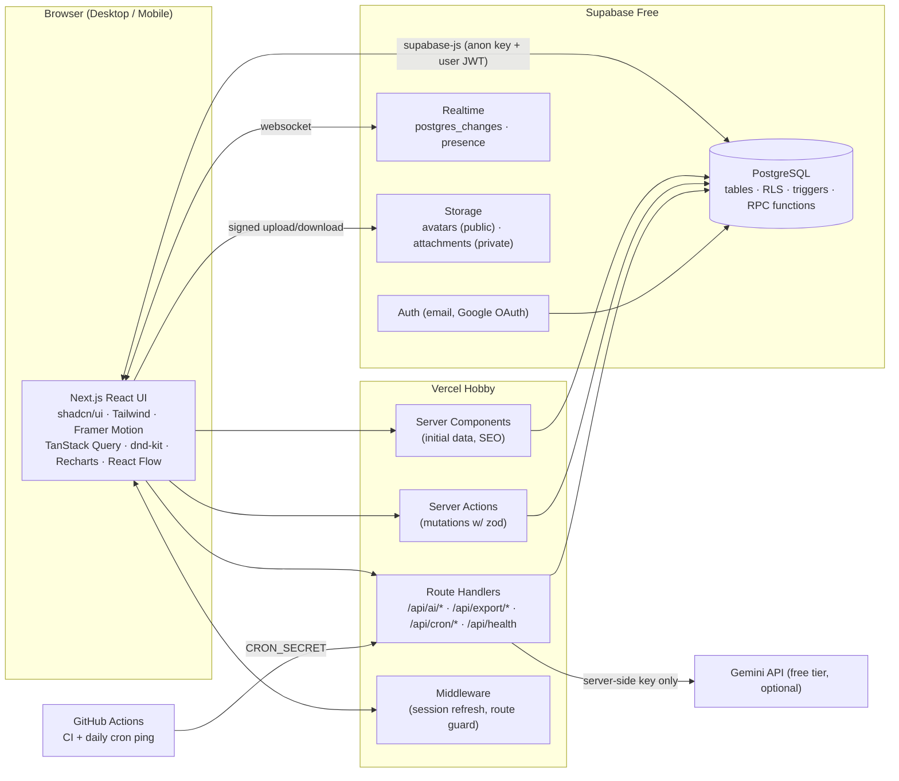
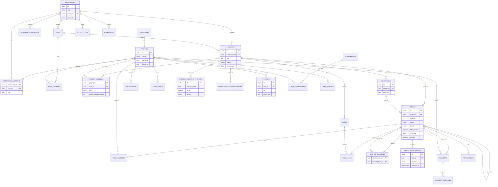
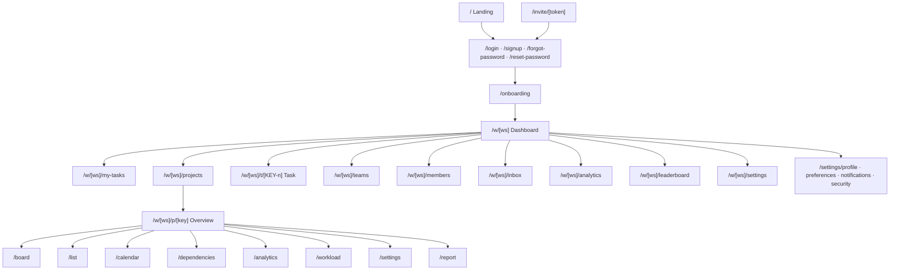
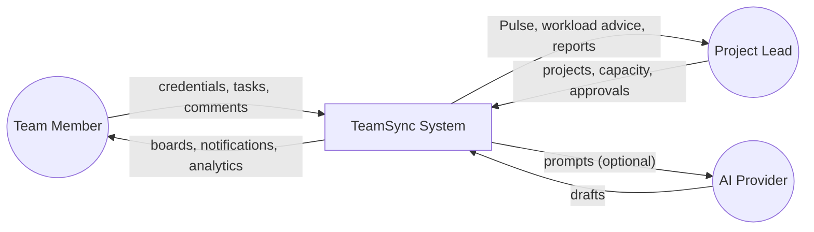
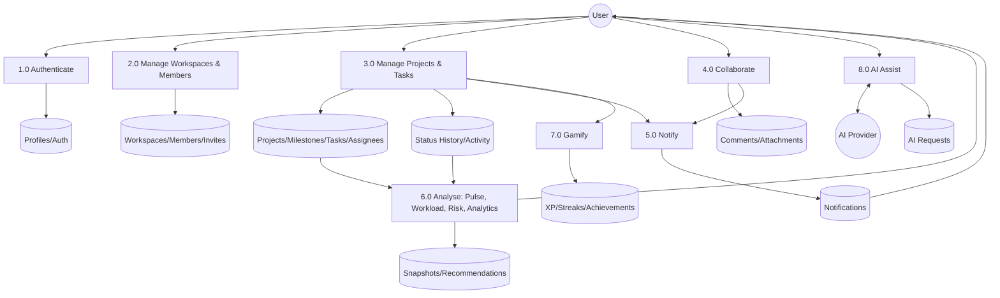

# TeamSync — Project Specification

> **Plan smarter. Collaborate better. Deliver together.**
>
> Version 1.0 · Prepared 8 November 2026 · Status: Approved for implementation
>
> This document is the **single source of truth** for TeamSync. Every phase prompt (`PHASE_1_PROMPT.md` … `PHASE_4_PROMPT.md`) defers to it. If a phase prompt and this file disagree, this file wins; record the conflict in `IMPLEMENTATION_TRACKER.md` → *Decisions & Deviations*.

---

## Table of Contents

- [A. Project Overview](#a-project-overview)
- [B. Complete Feature Specification](#b-complete-feature-specification)
- [C. System Architecture](#c-system-architecture)
- [D. Database Design](#d-database-design)
- [E. API Specification](#e-api-specification)
- [F. UI/UX Specification](#f-uiux-specification)
- [G. Algorithms](#g-algorithms)
- [H. Security](#h-security)
- [I. Testing](#i-testing)
- [J. Deployment](#j-deployment)
- [K. Academic Documentation](#k-academic-documentation)
- [L. Evaluation Criteria](#l-evaluation-criteria)
- [M. Risk Analysis](#m-risk-analysis)
- [Appendix 1 — Conventions](#appendix-1--conventions)
- [Appendix 2 — Feature Tiers (MVP vs Advanced)](#appendix-2--feature-tiers-mvp-vs-advanced)

---

## A. Project Overview

| Field | Value |
|---|---|
| Project title | Team Project Task Manager |
| Product name | TeamSync |
| Tagline | Plan smarter. Collaborate better. Deliver together. |
| Type | Full-stack, multi-tenant web application (SaaS-style) |
| Stack | Next.js (App Router) · TypeScript · Tailwind CSS · shadcn/ui · Supabase (PostgreSQL, Auth, Realtime, Storage, RLS) · Vercel Hobby · optional Gemini API |
| Cost to run | ₹0 — free tiers only (see `FREE_TIER_SERVICES.md`) |

### A.1 Abstract

Student teams and small groups routinely manage projects through chat threads and spreadsheets, which hide workload imbalance, missed dependencies and slipping deadlines until it is too late to recover. TeamSync is a multi-tenant collaboration platform in which users create workspaces, organise teams, plan projects into milestones and tasks, and collaborate in real time through Kanban, list and calendar views with comments, mentions and notifications. Beyond task tracking, TeamSync adds an intelligence layer computed from the team's real activity: **Project Pulse**, an explainable 0–100 health score built from completion, overdue work, deadline proximity, blocked work and workload balance; a **Workload Balance Engine** that measures each member's utilisation against declared capacity and proposes concrete reassignments; a **Dependency Map** that validates and visualises task dependencies; **analytics** (burndown, throughput, contribution and risk); **gamification** (XP, levels, streaks, achievements) awarded by the database so it cannot be forged; and an optional **AI Task Assistant** that drafts task breakdowns, summaries and risk narratives, always shown as a preview, rate-limited server-side, and backed by deterministic fallbacks so the product remains fully functional without AI. Data isolation between workspaces is enforced in PostgreSQL through Row Level Security. The system runs entirely on free tiers (Supabase Free, Vercel Hobby, Gemini free tier).

### A.2 Problem Statement

Small teams lack a single place that (1) records who owns what and by when, (2) shows how work is actually progressing against the plan, (3) reveals overloaded members and blocked chains early, and (4) does this without paid tooling or a steep learning curve. Existing free tools either stop at card-moving (no insight into risk or balance) or lock analytics and automation behind paid plans.

### A.3 Existing System

| Approach | Limitations |
|---|---|
| WhatsApp/Discord groups + shared spreadsheets | No ownership model, no deadlines enforcement, information lost in chat, no history |
| Basic Kanban boards (free tiers of commercial tools) | Little or no analytics on free plans; no workload view; dependencies and automation commonly paywalled; no explanation of *why* a project is at risk |
| Full enterprise PM suites | Too complex for student teams; advanced features are paid |

### A.4 Proposed System

A purpose-built platform that combines familiar task management (workspaces → projects → milestones → tasks, with Kanban/list/calendar) with an **explainable intelligence layer** computed from real data, real-time collaboration, and strict tenant isolation — at zero running cost.

### A.5 Objectives

1. Provide secure multi-tenant workspaces with role-based access enforced at the database layer (RLS).
2. Support the full task lifecycle: create, assign, prioritise, estimate, schedule, discuss, complete — with full audit history.
3. Deliver real-time collaboration (live board updates, presence, notifications).
4. Compute an explainable Project Pulse score (0–100) whose every point can be traced to a factor.
5. Detect workload imbalance and recommend reassignments that measurably reduce imbalance.
6. Validate task dependencies (no cycles) and visualise blocked chains.
7. Provide analytics derived only from recorded data — no mock numbers.
8. Offer AI assistance that is optional, previewed, rate-limited, and has deterministic fallbacks.
9. Achieve SaaS-grade UI quality, responsive from 360 px phones to wide desktops, WCAG 2.2 AA.
10. Deploy publicly on free tiers with reproducible setup, tests and documentation.

### A.6 Scope

**In scope:** everything in Section B. **Out of scope (future work):** native mobile apps, payments/billing, Gantt chart with critical-path scheduling, time tracking with timers, email digests at scale, third-party integrations (GitHub/Slack), offline mode, SSO/SAML, public API.

### A.7 Target Users & Personas

| Persona | Need |
|---|---|
| **Ananya — student team lead** | Split a semester project among 4–6 classmates, see who is falling behind, show progress to a guide |
| **Rahul — team member** | Know exactly what is assigned to him and what is due this week |
| **Club coordinator** | Run several event projects in one workspace with different teams |
| **Faculty guide (guest/viewer)** | Read-only view of progress and health without editing |
| **Small dev team PM** | Track milestones, dependencies, and risk |

### A.8 Expected Outcomes

A deployed, publicly reachable application; a database schema with RLS verified by automated tests; documented algorithms with unit tests; analytics computed from real usage; a demo workspace seeded through the app's own flows (not fabricated metrics); and an academic report/presentation package.

---

## B. Complete Feature Specification

### B.0 Roles & Permission Matrix

**Workspace roles** (`workspace_role` enum): `owner` (exactly one), `admin`, `member`, `guest`.
**Project roles** (`project_role` enum): `lead`, `contributor`, `viewer`.

Effective project permission = project role, except workspace `owner`/`admin` act as `lead` on every project in the workspace. Workspace `guest` can only ever be `viewer` on projects they are explicitly added to.

| Capability | Owner | Admin | Member | Guest |
|---|---|---|---|---|
| Rename workspace, change settings, toggle AI | ✅ | ✅ | ❌ | ❌ |
| Delete workspace / transfer ownership | ✅ | ❌ | ❌ | ❌ |
| Invite / remove members, change roles (not owner) | ✅ | ✅ | ❌ | ❌ |
| Create teams | ✅ | ✅ | ❌ | ❌ |
| Create projects | ✅ | ✅ | ✅ | ❌ |
| View workspace member directory | ✅ | ✅ | ✅ | limited (names/avatars of co-project members) |

| Capability (within a project) | Lead | Contributor | Viewer |
|---|---|---|---|
| Edit project, milestones, members, capacity | ✅ | ❌ | ❌ |
| Archive / delete project | ✅ | ❌ | ❌ |
| Create / edit tasks | ✅ | ✅ | ❌ |
| Delete any task | ✅ | own created only | ❌ |
| Assign tasks to others | ✅ | ✅ | ❌ |
| Comment | ✅ | ✅ | ✅ |
| Add/remove dependencies | ✅ | ✅ | ❌ |
| Override "done while blocked" | ✅ | ❌ | ❌ |
| Apply workload recommendations | ✅ | ❌ | ❌ |
| Use AI assistant (if enabled) | ✅ | ✅ | ❌ |
| View analytics / Pulse | ✅ | ✅ | ✅ |

### B.1 Authentication

- **Purpose:** Secure identity using Supabase Auth.
- **User stories:** As a visitor I can sign up with email/password or Google; as a user I can log in, log out, reset my password, and stay signed in across refreshes.
- **Functional requirements:** Email + password sign-up with confirmation (configurable); Google OAuth (free; optional GitHub OAuth); password reset via email link; session cookies managed by `@supabase/ssr`; middleware refreshes sessions and protects `/w/**`, `/onboarding`, `/settings/**`; a `profiles` row is created automatically by a trigger on `auth.users` insert.
- **Inputs:** email, password (min 8 chars, at least 1 letter and 1 number), full name.
- **Outputs:** session; redirect to `/onboarding` (no workspace yet) or last-visited workspace.
- **Business logic:** after login, look up `profiles.last_workspace_id`; if user is still a member, redirect there, else first workspace, else `/onboarding`.
- **Permissions:** public routes: `/`, `/login`, `/signup`, `/forgot-password`, `/reset-password`, `/auth/callback`, `/invite/[token]` (shows invite, requires login to accept).
- **Backend:** Supabase Auth; trigger `handle_new_user()`; `auth/callback` route exchanges OAuth/PKCE code.
- **Frontend:** split-screen auth layout, inline validation (react-hook-form + zod), show/hide password, loading buttons, OAuth button, error toasts mapped to friendly messages.
- **Error cases:** invalid credentials (generic message — never reveal whether an email exists), unconfirmed email, rate-limited email sending (Supabase built-in SMTP is heavily rate limited — show "try again later"), OAuth cancelled, expired reset link.
- **Acceptance:** new user can sign up → land in onboarding; refresh keeps session; protected routes redirect anonymous users to `/login?next=…`; logout clears session on all tabs.

### B.2 Onboarding & Profile

- **Purpose:** Get a new user to a usable workspace in < 60 seconds.
- **Flow (3 steps):** (1) Profile — name, avatar (optional), role title, timezone (auto-detected); (2) Create workspace — name, slug (auto, editable, unique), or "I have an invite link"; (3) Optional first project — name, key (2–5 uppercase letters), template: *Blank*, *College Project (Research → Build → Test → Report)*, *Event Planning*. Templates create milestones and starter task **titles** only — no fake progress.
- **Profile settings:** full name, display handle (unique within platform, used for @mentions), avatar upload (≤ 2 MB, png/jpg/webp), job title, timezone, week start (Mon/Sun), theme (system/light/dark), reduced motion, notification preferences, weekend streak protection toggle.
- **Acceptance:** onboarding cannot be skipped without a workspace; slug collisions handled with suggestion; avatar shows everywhere within 1 s of upload.

### B.3 Workspaces

- **Purpose:** Tenant boundary. Every domain row belongs (directly or transitively) to exactly one workspace.
- **Stories:** create workspace; switch between workspaces; invite people; change roles; leave; owner transfers ownership; owner deletes workspace (type-name-to-confirm).
- **Requirements:** workspace switcher in sidebar; invite by **link** (token, role, expiry 7 days, optional max uses) and by **email address** (creates invitation row; email sending optional — link is always copyable); members page with role dropdowns; owner cannot leave without transferring.
- **Business logic:** creating a workspace atomically inserts workspace + owner membership (RPC `create_workspace`). Accepting an invite (RPC `accept_invitation`) validates token, expiry, uses, and that the email matches if the invite is email-bound.
- **Error cases:** slug taken, invite expired/revoked/exhausted, already a member, last-owner protection, guest attempting member actions.
- **Acceptance:** user A in workspace X can never read any row from workspace Y (verified by RLS tests).

### B.4 Teams

- **Purpose:** Group workspace members (e.g., "Frontend", "Design", "Logistics") for quick bulk-adding to projects and team-level analytics.
- **Requirements:** CRUD teams (owner/admin); add/remove members; team colour and icon; "Add team to project" adds all team members as contributors; team page shows members and their active projects.
- **Acceptance:** removing a member from the workspace cascades their team memberships.

### B.5 Projects

- **Purpose:** Container for milestones and tasks.
- **Fields:** name, key (unique per workspace, 2–5 uppercase letters, used in task IDs like `TS-42`), description (markdown), icon/emoji, colour, status (`planning`, `active`, `on_hold`, `completed`, `archived`), start date, target date, visibility (`workspace` — all members can view; `private` — only project members), team (optional).
- **Pages:** Overview, Board, List, Calendar, Dependencies, Analytics, Workload, Settings.
- **Project members:** role + `weekly_capacity_points` (default 20) used by Workload Balance.
- **Business logic:** creator becomes `lead`. Archiving hides from default lists and makes it read-only. Delete is soft (sets `deleted_at`) with 30-day restore by lead; hard delete by owner.
- **Acceptance:** private projects are invisible (not even in search) to non-members.

### B.6 Milestones

- **Fields:** name, description, due date, status (`open`, `completed`), sort order.
- **Logic:** progress = done effort ÷ total effort of tasks in milestone (null if no tasks). Milestone appears on calendar. A milestone is flagged *at risk* if its forecast completion (Section G.5) is after its due date.
- **Acceptance:** progress bar matches task data exactly.

### B.7 Tasks

- **Fields:** project, milestone (optional), parent task (one level of subtasks), number (per-project sequence → `KEY-n`), title (1–200 chars), description (markdown, ≤ 20 000 chars), status (`backlog`, `todo`, `in_progress`, `in_review`, `done`, `cancelled`), priority (`urgent`, `high`, `medium`, `low`, `none`), effort points (Fibonacci-like: 1,2,3,5,8,13; default 1 when unset for calculations), start date, due date, `is_blocked` + `blocked_reason` (manual block), labels, assignees (0..n), position (for ordering within a status column), created_by, completed_at, timestamps.
- **Stories:** create quickly (inline "+" in a column, `C` keyboard shortcut, or command palette); edit in a side sheet / full page; assign multiple people; add subtasks; set dates with natural language shortcuts ("tomorrow", "fri", "+3d"); duplicate; move between projects of the same workspace (lead of both).
- **Business logic:**
  - `completed_at` set by trigger when status becomes `done`, cleared when leaving `done`.
  - Every status change inserts a row into `task_status_history` (trigger) — the basis of burndown/throughput. **This must exist from Phase 2 so analytics in Phase 3 have real history.**
  - A task is *effectively blocked* if `is_blocked = true` OR it has at least one dependency whose blocker task is not `done`/`cancelled`.
  - Moving an effectively-blocked task to `done` is rejected for non-leads (error `TASK_BLOCKED`); leads may override with a reason (logged).
  - Parent task cannot be `done` while subtasks are open (warning + confirm; server enforces unless lead override).
- **Error cases:** stale update (optimistic UI rollback on error), invalid date range (start > due), assigning a non-member (rejected by FK/RLS check), viewer attempting edit.
- **Acceptance:** all fields persist; history rows created on every status change; `KEY-n` numbers never repeat within a project.

### B.8 Task Assignments

- Multiple assignees via `task_assignees`. Effort for workload is **split equally** among assignees.
- Assigning someone creates a notification and an activity entry. Self-assign button ("Take it").
- Only project members with role ≠ viewer can be assigned.

### B.9 Kanban Board

- Columns = statuses (`backlog` collapsible, `todo`, `in_progress`, `in_review`, `done`; `cancelled` hidden behind filter).
- Drag-and-drop with `@dnd-kit` (keyboard accessible: space to lift, arrows to move, space to drop). Ordering uses fractional `position` (numeric); RPC `move_task` updates status + position atomically.
- Card shows: key, title, priority icon, labels (max 3 + "+n"), assignee avatars (max 3 + "+n"), due chip (red overdue, amber ≤ 48 h), subtask progress, comment count, blocked badge, effort points.
- WIP hint: column header shows count and effort sum; optional WIP limit per project (visual warning only).
- Swimlanes toggle: none / by assignee / by priority / by milestone.
- Realtime: other users' moves animate in; presence avatars at top show who is viewing.
- Mobile (< 768 px): one column at a time with horizontal snap scrolling and a status tab bar; long-press to drag, or "Move to…" menu.

### B.10 List View

- Dense table with sortable columns (key, title, status, priority, assignees, due, effort, milestone, updated), grouping (status/assignee/milestone/priority), inline edit of status/priority/assignee/due, multi-select bulk actions (status, priority, assignee, milestone, delete), virtualised rows when > 200 tasks.

### B.11 Calendar

- Month and week views (custom grid with `date-fns`; no paid calendar library). Tasks shown on due date (or spanning start→due in week view); milestones shown as diamond markers. Drag a task to another day to change its due date (contributor+). Unscheduled tasks drawer. Mobile: agenda list.

### B.12 Dependencies *(Phase 3)*

- Relationship: `blocker_task_id` **blocks** `blocked_task_id`; both must be in the same project.
- Validation: no self-dependency, no duplicates, **no cycles** (Section G.6), enforced in the database.
- UI: "Blocked by / Blocking" section in task detail with search-to-add; Dependency Map page (Section B.20).
- Warning when a blocker's due date is after the blocked task's due date ("schedule conflict").

### B.13 Comments & Mentions

- Markdown comments (sanitised render), edit (shows "edited"), delete own (lead can delete any), emoji reactions (optional, advanced), `@handle` mentions with autocomplete limited to project members; mention creates notification.
- Attachments on comments/tasks: Supabase Storage private bucket, ≤ 5 MB each, MIME allowlist (images, pdf, txt, md, docx, xlsx, pptx, zip), signed URLs (60 min).
- Realtime: new comments appear live.

### B.14 Notifications

- Types: `task_assigned`, `mentioned`, `comment_on_assigned`, `status_changed_on_assigned`, `due_soon` (≤ 24 h), `overdue`, `invited_to_project`, `achievement_unlocked`, `rebalance_suggested`.
- Created **server-side only** (DB triggers / cron), never inserted by clients.
- Inbox page + bell popover with unread count (realtime), mark read/unread, mark all read, filter by type, click-through deep links.
- Preferences per type (in-app on/off). Email notifications are out of scope for MVP.

### B.15 Activity Logs

- Append-only `activity_logs` written by triggers for: task created/updated (field-level diff for status, priority, assignees, due date, title), comment added, member joined/left, project created/archived, dependency added/removed, rebalance applied, AI suggestion applied.
- Displayed as project feed, task timeline (in task detail), and workspace dashboard "Recent activity". Clients have no INSERT/UPDATE/DELETE policy on this table.

### B.16 Search

- Command palette (`⌘K` / `Ctrl+K`) searching tasks (by key, title, description), projects, members, and navigation commands.
- Postgres full-text search (`tsvector` generated column + GIN index) plus key-prefix match (`TS-42`). RPC `search_workspace` runs as `SECURITY INVOKER` so RLS applies.
- Results grouped, keyboard navigable, debounced 200 ms, recent searches stored locally.

### B.17 Filters & Saved Views

- Filter bar shared by Board/List/Calendar: assignee (incl. "me", "unassigned"), status, priority, label, milestone, due (overdue, today, this week, no date), blocked, text. Filters are URL query parameters (shareable). Saved views per user per project (`saved_views` table).

### B.18 Analytics *(Phase 3)*

All charts built with Recharts from real tables; each chart has an empty state when data is insufficient.

| Chart | Source | Definition |
|---|---|---|
| Burndown (per project or milestone) | `task_status_history`, `tasks` | Remaining effort per day from start to target date, plus ideal line |
| Cumulative flow | `task_status_history` | Effort per status per day |
| Throughput / completion trend | `tasks.completed_at` | Tasks & effort completed per week (last 12 weeks) |
| Cycle time | `task_status_history` | Median days from first `in_progress` to `done` |
| Workload distribution | open `tasks` + `task_assignees` + capacity | Utilisation per member |
| Member contributions | `tasks`, `comments`, `xp_events` | Completed effort, comments, reviews per member (period selectable) |
| Pulse trend | `project_health_snapshots` | Daily Pulse score with factor breakdown |
| Risk analytics | live risk detector | Count of risks by type; overdue by priority |

Workspace analytics page aggregates across projects the user can see.

### B.19 Project Pulse *(Phase 3)*

Explainable 0–100 health score (Section G.1) shown as an animated ring on project overview and project cards, with band (Healthy / Watch / At Risk / Critical), factor bars, the top 3 "why" explanations, and actionable suggestions ("3 urgent tasks are overdue — open them"). Daily snapshot stored for trend. Score is `null` with "Not enough data" when the project has fewer than 3 non-cancelled tasks.

### B.20 Dependency Map *(Phase 3)*

Interactive graph (`@xyflow/react`, MIT) with automatic top-to-bottom layout (`dagre` or `elkjs`, both free). Nodes coloured by status, red outline for effectively-blocked, thick edges for the **longest open chain** (by remaining effort). Click node → task sheet. Filter by milestone/assignee. Mobile: falls back to an indented "blocked-by tree" list.

### B.21 Workload Balance Engine *(Phase 3)*

Per project: utilisation bars per member (load ÷ capacity), status chip (Under-utilised / Balanced / Overloaded), imbalance index, and up to 5 reassignment recommendations each with "before → after" utilisation and the resulting imbalance reduction (Section G.2). Leads can **Apply** (atomic RPC, logged, notifies both people) or **Dismiss**. Capacity editable by lead.

### B.22 AI Task Assistant *(Phase 3, optional)*

| Capability | Input | Output (validated JSON) | Fallback without AI |
|---|---|---|---|
| Plan project | project goal text, dates | milestones[] with tasks[] (title, description, priority, effort) | Template planner (keyword-matched templates: software, research, event, report) |
| Break down task | task title/description | subtasks[] (title, effort) | Rule-based split: "Research / Implement / Test / Document / Review" adapted to task type keywords |
| Summarise project | real project stats + recent activity (computed server-side) | summary markdown (≤ 200 words) | Deterministic template summary from the same stats |
| Recommend priorities | open tasks with due/effort/blocking counts | ranked task ids + reason | Deterministic priority score (G.5) |
| Explain risks | Pulse factors + risk list | narrative + 3 actions | Template sentences from risk list |

Rules: every AI output is shown as an **editable preview**; nothing is written until the user clicks *Apply*; AI never invents metrics — summaries receive numbers computed by the server and are instructed to use only those; per-user and per-workspace daily limits; workspace admins can disable AI; UI states clearly when fallback was used ("Generated by rules — AI unavailable"). Privacy notice: free-tier prompts may be used by the provider to improve products, so the assistant sends only titles/descriptions/stats, never emails or attachments.

### B.23 Gamification *(Phase 3)*

XP for completing tasks (scaled by priority, effort, on-time), reviews, helpful activity; levels; daily productivity streak; achievements (catalogue below); workspace leaderboard (weekly/monthly/all-time, opt-out in profile). All awards computed in the database by triggers; client cannot write XP.

| Achievement code | Name | Rule |
|---|---|---|
| `first_task` | First Blood | Complete first task |
| `ten_tasks` | Momentum | Complete 10 tasks |
| `fifty_tasks` | Machine | Complete 50 tasks |
| `on_time_10` | Punctual | 10 tasks done on/before due date |
| `streak_7` | On Fire | 7-day streak |
| `streak_30` | Unstoppable | 30-day streak |
| `unblocker` | Unblocker | Complete a task that was blocking ≥ 2 open tasks |
| `helper` | Team Player | 25 comments on others' tasks |
| `rescuer` | Rescuer | Accept a rebalance reassignment and complete it |
| `milestone_closer` | Closer | Complete the last open task of a milestone |

### B.24 Productivity Insights *(Phase 3)*

Personal "My week" card: tasks completed, effort, on-time rate, streak, most productive weekday (from own history, needs ≥ 14 days data), upcoming due work. Uses only the user's real data; shows "Collecting data…" until thresholds are met.

### B.25 Settings

- **Personal:** profile, preferences (theme, density, reduced motion, week start, timezone), notifications, security (change password, sign out other sessions, delete account with ownership checks).
- **Workspace:** general (name, slug, logo), members & invites, teams, AI (enable/disable, daily limit display), gamification (enable/disable leaderboard), danger zone (transfer, delete).
- **Project:** details, members & capacity, labels, WIP limits, archive/delete.

### B.26 Export

- CSV export of tasks (respects current filters) — generated server-side by route handler streaming CSV, RLS applied.
- Printable project report (`/w/[ws]/p/[key]/report`) with print stylesheet → browser "Save as PDF" (no paid PDF service). Includes Pulse, milestones, burndown snapshot, member contributions.
- Personal data export (JSON of own profile, comments, tasks created) from security settings.

---

## C. System Architecture

### C.1 Overview Diagram



### C.2 Layer Responsibilities

| Layer | Responsibility | Must NOT |
|---|---|---|
| **Frontend (Client Components)** | Interactivity, optimistic updates, drag-and-drop, realtime subscriptions, forms | Hold secrets; be trusted for authorization; compute XP |
| **Server Components** | First render with data fetched under the user's session; layout shells | Use service-role key |
| **Server Actions** | Validated (zod) mutations that need multiple steps or revalidation; call RPCs | Bypass RLS (they use the user's session client) |
| **Route Handlers** | AI proxy, CSV export, cron endpoints, health check | Expose stack traces; run longer than the Hobby function limit |
| **Middleware** | Refresh Supabase session cookie; redirect unauthenticated users | Query the database heavily |
| **PostgreSQL** | Source of truth; RLS authorization; integrity constraints; triggers for history, activity, notifications, XP; atomic RPCs | Trust any client-supplied `user_id` (always use `auth.uid()`) |
| **Realtime** | Push row changes (tasks, comments, notifications) and presence | Carry data the user's RLS forbids (Realtime respects RLS for `postgres_changes`) |
| **Storage** | Files, with bucket policies mirroring RLS | Serve private files without signed URLs |
| **AI** | Draft text/structures | Write to DB directly; see emails, files or secrets |

### C.3 Frontend Architecture

- Next.js App Router, TypeScript `strict`, route groups: `(marketing)`, `(auth)`, `(app)`.
- Folder layout:

```
src/
  app/
    (marketing)/page.tsx
    (auth)/login|signup|forgot-password|reset-password/
    auth/callback/route.ts
    (app)/onboarding/
    (app)/invite/[token]/
    (app)/w/[workspaceSlug]/(dashboard|projects|p/[projectKey]/...|t/[taskKey]|my-tasks|teams|members|inbox|analytics|leaderboard|settings)/
    (app)/settings/(profile|preferences|notifications|security)/
    api/(ai|export|cron|health)/
  components/
    ui/            # shadcn primitives (generated)
    brand/         # logo, pulse ring, illustrations
    layout/        # app shell, sidebar, topbar, mobile nav
    tasks/ board/ list/ calendar/ analytics/ pulse/ workload/ deps/ ai/ gamification/
  lib/
    supabase/ (client.ts, server.ts, middleware.ts, admin.ts — admin used ONLY in cron/server code)
    algorithms/ (pulse.ts, workload.ts, risk.ts, forecast.ts, priority.ts) — pure, unit-tested
    ai/ (gemini.ts, prompts.ts, schemas.ts, fallbacks.ts, rate-limit.ts)
    validation/ (zod schemas shared by forms and actions)
    utils/ (dates, fractional-index, csv, format)
  hooks/ (use-realtime-*, use-hotkeys, use-workspace)
  types/database.ts  # generated by `supabase gen types typescript`
supabase/
  migrations/  seed.sql  tests/ (pgTAP)
tests/ (unit/, e2e/)
```

- State: server state via TanStack Query (keys: `['tasks', projectId, filters]` …); URL state for filters; minimal client state (Zustand optional for UI-only state such as command palette).
- Data access rule: **reads** may use supabase-js directly from client or server under RLS; **multi-row or invariant-bearing writes** go through Postgres RPC functions (atomic) called from Server Actions or the client.

### C.4 Backend Architecture

Supabase-first. Business invariants live in PostgreSQL (constraints, triggers, `SECURITY DEFINER` RPCs with explicit permission checks). Next.js server code is a thin orchestration layer plus the AI proxy and cron endpoints. Rationale: one place to enforce rules, works identically from any client, testable with pgTAP.

### C.5 Authentication Architecture

Supabase Auth issues JWTs; `@supabase/ssr` stores them in HTTP-only cookies; middleware refreshes them. Every query carries the user JWT; RLS policies reference `auth.uid()`. Service-role key exists only in Vercel server env and is used only by `/api/cron/*` (validated with `CRON_SECRET`) — never in user-request paths.

### C.6 Realtime Architecture

- One channel per open project page: `project:{projectId}` subscribing to `postgres_changes` on `tasks`, `task_assignees`, `comments` filtered by `project_id=eq.{id}`, plus **presence** (user id, name, avatar, current view).
- One channel per user: `user:{userId}` for `notifications` (`user_id=eq.{uid}`).
- Tables added to the `supabase_realtime` publication explicitly; RLS applies to change events.
- Budget: Free plan allows ~200 concurrent connections — a typical user holds 2 channels on one socket; unsubscribe on route change; reconnect with backoff.
- Client merges events into the TanStack Query cache; ignores echoes of its own optimistic mutations using a `client_mutation_id`.

### C.7 AI Integration Architecture

```mermaid
sequenceDiagram
  participant U as User
  participant FE as Next.js client
  participant API as /api/ai/[action] (server)
  participant DB as PostgreSQL
  participant G as Gemini API
  U->>FE: "Break down this task"
  FE->>API: POST {taskId} (session cookie)
  API->>DB: verify membership + workspace.ai_enabled
  API->>DB: rpc consume_ai_quota(workspace, user, action)
  alt quota ok & key configured
    API->>DB: fetch minimal context under RLS
    API->>G: prompt (system rules + JSON schema), timeout 8s
    G-->>API: JSON
    API->>API: zod validate; on failure → fallback
  else quota exceeded / no key / error / timeout
    API->>API: deterministic fallback
  end
  API->>DB: log ai_requests (status, source=ai|fallback, tokens)
  API-->>FE: {source, data}
  FE-->>U: editable preview → Apply (separate mutation)
```

Model name is configured by env var (`GEMINI_MODEL`) because model names and free-tier eligibility change; default to a currently free-tier Flash/Flash-Lite model verified at deploy time.

### C.8 Deployment Architecture

GitHub repository → Vercel (Preview deployment per PR, Production on `main`) → Supabase project (production) ; second Supabase free project or local Supabase (Docker) for development. GitHub Actions runs lint, typecheck, unit tests, pgTAP (if local Supabase available) and Playwright against preview; a scheduled workflow calls `/api/cron/daily` once a day (Pulse snapshots, due-soon/overdue notifications, streak rollover) which also prevents free-project auto-pause.

---

## D. Database Design

### D.1 Conventions

- `uuid` primary keys (`gen_random_uuid()`), `timestamptz` for times (`created_at default now()`, `updated_at` maintained by `set_updated_at()` trigger), `date` for calendar dates (due dates are dates, not timestamps — avoids timezone bugs).
- Every tenant table carries `workspace_id` (denormalised where needed) to make RLS cheap and uniform.
- Soft delete via `deleted_at` only on `workspaces`, `projects`, `tasks`.
- Enums: `workspace_role`, `project_role`, `project_status`, `task_status`, `task_priority`, `notification_type`, `milestone_status`, `project_visibility`, `invite_status`.
- Text length constraints via `CHECK (char_length(x) BETWEEN …)`.

### D.2 Tables

#### 1. `profiles` — public user profile (1:1 with `auth.users`)
| Column | Type | Constraints |
|---|---|---|
| id | uuid | PK, FK → auth.users(id) ON DELETE CASCADE |
| full_name | text | NOT NULL, 1–80 chars |
| handle | citext | UNIQUE, NOT NULL, `^[a-z0-9_]{3,20}$` |
| avatar_url | text | nullable |
| job_title | text | ≤ 80 |
| timezone | text | NOT NULL default 'Asia/Kolkata' (validated against `pg_timezone_names` in trigger) |
| week_start | smallint | default 1 (Mon), CHECK in (0,1) |
| theme | text | default 'system', CHECK in ('system','light','dark') |
| reduced_motion | boolean | default false |
| weekend_streak_protection | boolean | default true |
| show_on_leaderboard | boolean | default true |
| notification_prefs | jsonb | default '{}' |
| last_workspace_id | uuid | nullable FK → workspaces ON DELETE SET NULL |
| onboarded_at | timestamptz | nullable |
| created_at, updated_at | timestamptz | |

Index: unique on `handle`.

#### 2. `workspaces`
| Column | Type | Constraints |
|---|---|---|
| id | uuid | PK |
| name | text | NOT NULL 2–60 |
| slug | citext | UNIQUE NOT NULL `^[a-z0-9-]{3,40}$` |
| logo_url | text | |
| owner_id | uuid | NOT NULL FK → profiles |
| ai_enabled | boolean | default true |
| ai_daily_limit | int | default 100, CHECK 0–1000 |
| gamification_enabled | boolean | default true |
| deleted_at | timestamptz | |
| created_at, updated_at | | |

#### 3. `workspace_members`
| Column | Type | Constraints |
|---|---|---|
| workspace_id | uuid | FK → workspaces ON DELETE CASCADE |
| user_id | uuid | FK → profiles ON DELETE CASCADE |
| role | workspace_role | NOT NULL default 'member' |
| joined_at | timestamptz | default now() |
| PK | (workspace_id, user_id) | |

Index: `(user_id)`. Constraint: exactly one owner per workspace enforced by partial unique index `UNIQUE (workspace_id) WHERE role='owner'` + trigger preventing removal of the owner row.

#### 4. `workspace_invitations`
| Column | Type | Constraints |
|---|---|---|
| id | uuid | PK |
| workspace_id | uuid | FK CASCADE |
| token_hash | text | UNIQUE NOT NULL (SHA-256 of random 32-byte token; raw token only shown once) |
| email | citext | nullable (null = open link) |
| role | workspace_role | NOT NULL, CHECK role <> 'owner' |
| invited_by | uuid | FK → profiles |
| max_uses | int | default 1, CHECK ≥ 1 |
| use_count | int | default 0 |
| expires_at | timestamptz | NOT NULL default now()+7 days |
| status | invite_status | 'active','revoked','exhausted','expired' |
| created_at | | |

#### 5. `teams` / 6. `team_members`
`teams(id, workspace_id FK, name 1–40, color text, icon text, created_by, created_at, updated_at, UNIQUE(workspace_id, name))`
`team_members(team_id FK CASCADE, user_id FK CASCADE, workspace_id, added_at, PK(team_id,user_id))` — trigger ensures user is a workspace member.

#### 7. `projects`
| Column | Type | Constraints |
|---|---|---|
| id | uuid | PK |
| workspace_id | uuid | FK CASCADE, NOT NULL |
| team_id | uuid | FK → teams SET NULL |
| name | text | 2–80 |
| key | text | `^[A-Z]{2,5}$`, UNIQUE(workspace_id, key) |
| description | text | ≤ 10 000 |
| icon, color | text | |
| status | project_status | default 'active' |
| visibility | project_visibility | default 'workspace' |
| start_date, target_date | date | CHECK target_date ≥ start_date |
| task_counter | int | default 0 (for KEY-n numbering) |
| wip_limits | jsonb | default '{}' e.g. {"in_progress":5} |
| created_by | uuid | FK profiles |
| deleted_at, created_at, updated_at | | |

Indexes: `(workspace_id, status)`.

#### 8. `project_members`
`(project_id FK CASCADE, user_id FK CASCADE, workspace_id, role project_role default 'contributor', weekly_capacity_points int default 20 CHECK 0–200, added_at, PK(project_id,user_id))` — trigger: user must be workspace member; guests forced to `viewer`.

#### 9. `milestones`
`(id, project_id FK CASCADE, workspace_id, name 1–80, description, due_date date, status milestone_status default 'open', sort_order int, created_at, updated_at)` Index `(project_id, due_date)`.

#### 10. `tasks`
| Column | Type | Constraints |
|---|---|---|
| id | uuid | PK |
| workspace_id | uuid | NOT NULL (copied from project by trigger) |
| project_id | uuid | FK CASCADE NOT NULL |
| milestone_id | uuid | FK SET NULL |
| parent_task_id | uuid | FK → tasks CASCADE; CHECK parent ≠ id; trigger: parent must have no parent (1 level) and same project |
| number | int | NOT NULL; UNIQUE(project_id, number) (assigned by trigger from projects.task_counter) |
| title | text | 1–200 |
| description | text | ≤ 20 000 |
| status | task_status | default 'todo' |
| priority | task_priority | default 'none' |
| effort_points | smallint | nullable, CHECK in (1,2,3,5,8,13) |
| start_date, due_date | date | CHECK due ≥ start |
| is_blocked | boolean | default false |
| blocked_reason | text | ≤ 300 |
| position | numeric | NOT NULL (fractional index within status column) |
| created_by | uuid | FK profiles |
| completed_at | timestamptz | maintained by trigger |
| search_vector | tsvector | GENERATED ALWAYS AS (setweight(to_tsvector('simple', coalesce(title,'')),'A') ‖ setweight(to_tsvector('simple', coalesce(description,'')),'B')) STORED |
| deleted_at, created_at, updated_at | | |

Indexes: `(project_id, status, position)`, `(workspace_id, due_date) WHERE deleted_at IS NULL`, `(milestone_id)`, `(parent_task_id)`, GIN `(search_vector)`.

#### 11. `task_assignees`
`(task_id FK CASCADE, user_id FK CASCADE, project_id, workspace_id, assigned_by, assigned_at, PK(task_id,user_id))` Index `(user_id, workspace_id)`. Trigger: assignee must be project member with role ≠ viewer.

#### 12. `labels` / 13. `task_labels`
`labels(id, project_id FK CASCADE, workspace_id, name 1–30, color, UNIQUE(project_id,name))`; `task_labels(task_id, label_id, workspace_id, PK(task_id,label_id))`.

#### 14. `task_dependencies` *(Phase 3)*
`(id, workspace_id, project_id, blocker_task_id FK CASCADE, blocked_task_id FK CASCADE, created_by, created_at, UNIQUE(blocker_task_id, blocked_task_id), CHECK blocker ≠ blocked)` Indexes on both task columns. Trigger `prevent_dependency_cycle()` (G.6).

#### 15. `task_status_history`
`(id bigserial PK, task_id FK CASCADE, project_id, workspace_id, from_status task_status null, to_status task_status, effort_points smallint, changed_by uuid, changed_at timestamptz default now())` Index `(project_id, changed_at)`. Insert-only via trigger (also logs initial status on task insert with `from_status = null`).

#### 16. `comments`
`(id, task_id FK CASCADE, project_id, workspace_id, author_id FK, body text 1–10 000, edited_at, deleted_at, created_at)` Index `(task_id, created_at)`.

#### 17. `comment_mentions`
`(comment_id FK CASCADE, user_id FK CASCADE, PK(comment_id,user_id))` — filled by trigger parsing `@handle` against project members.

#### 18. `attachments`
`(id, workspace_id, project_id, task_id FK CASCADE, comment_id FK CASCADE null, storage_path text UNIQUE, file_name ≤ 200, mime_type, size_bytes int CHECK ≤ 5 242 880, uploaded_by, created_at)`; storage path format `{workspace_id}/{project_id}/{task_id}/{uuid}-{sanitized_name}`.

#### 19. `activity_logs`
`(id bigserial, workspace_id, project_id null, task_id null, actor_id null, action text, entity_type text, entity_id uuid, metadata jsonb, created_at)` Indexes `(project_id, created_at desc)`, `(workspace_id, created_at desc)`, `(task_id, created_at)`.

#### 20. `notifications`
`(id, user_id FK CASCADE, workspace_id, type notification_type, title ≤ 140, body ≤ 500, link text, actor_id, entity_id, read_at, created_at)` Index `(user_id, read_at, created_at desc)`. Dedup partial unique index for `due_soon`/`overdue`: `UNIQUE(user_id, type, entity_id, (created_at::date))`.

#### 21. `saved_views`
`(id, user_id, project_id, workspace_id, name 1–40, view_type text CHECK in ('board','list','calendar'), filters jsonb, created_at)`.

#### 22. `project_health_snapshots` *(Phase 3)*
`(id, project_id FK CASCADE, workspace_id, snapshot_date date, score smallint null CHECK 0–100, band text, factors jsonb, open_tasks int, overdue_tasks int, blocked_tasks int, remaining_effort int, completed_effort int, created_at, UNIQUE(project_id, snapshot_date))`.

#### 23. `workload_recommendations` *(Phase 3)*
`(id, project_id, workspace_id, task_id, from_user_id, to_user_id, reason text, imbalance_before numeric, imbalance_after numeric, status text CHECK in ('open','applied','dismissed','stale'), created_at, resolved_by, resolved_at)`.

#### 24. `xp_events` *(Phase 3)*
`(id bigserial, workspace_id, user_id, source_type text CHECK in ('task','comment','achievement','review'), source_id uuid, event_type text, xp int, created_at, UNIQUE(user_id, source_type, source_id, event_type))` — the unique key makes awards idempotent; reopening a task inserts a compensating `task_reopened` event with negative xp.

#### 25. `achievements` / 26. `user_achievements` *(Phase 3)*
`achievements(code text PK, name, description, icon, xp_reward int)` (seeded catalogue — reference data, not fabricated metrics); `user_achievements(user_id, workspace_id, achievement_code FK, unlocked_at, PK(user_id, workspace_id, achievement_code))`.

#### 27. `user_streaks` *(Phase 3)*
`(user_id, workspace_id, current_streak int, longest_streak int, last_active_date date, PK(user_id, workspace_id))`.

#### 28. `ai_requests` *(Phase 3)*
`(id, workspace_id, user_id, action text, source text CHECK in ('ai','fallback'), status text CHECK in ('ok','error','rate_limited','disabled','invalid_output'), input_tokens int, output_tokens int, latency_ms int, created_at)` Index `(workspace_id, created_at)`, `(user_id, created_at)`.

**Views (SECURITY INVOKER):** `v_member_stats` (per workspace member XP sum, level, tasks completed), `v_task_effective` (task + `effectively_blocked` boolean + open blocker count).

### D.3 ER Diagram



### D.4 Row Level Security

RLS is **enabled on every table in `public`** (migration fails CI if any table lacks it — Phase 4 audit query in Section H.3).

**Helper functions** (`SECURITY DEFINER`, `STABLE`, `SET search_path = public`, owned by `postgres`, `REVOKE ALL … FROM public` then `GRANT EXECUTE … TO authenticated`):

```sql
is_workspace_member(ws uuid) returns boolean      -- row exists in workspace_members for auth.uid()
workspace_role_of(ws uuid) returns workspace_role -- null if not member
is_workspace_admin(ws uuid) returns boolean       -- role in ('owner','admin')
can_view_project(p uuid) returns boolean          -- project not deleted AND (
                                                  --   (visibility='workspace' AND member AND role<>'guest')
                                                  --   OR is project member OR is_workspace_admin)
project_role_of(p uuid) returns project_role      -- 'lead' if workspace admin, else project_members.role
can_edit_project_content(p uuid) returns boolean  -- project_role_of in ('lead','contributor') AND project status <> 'archived'
is_project_lead(p uuid) returns boolean
```

**Policy summary**

| Table | SELECT | INSERT | UPDATE | DELETE |
|---|---|---|---|---|
| profiles | self, or shares ≥ 1 workspace with self | (trigger only) | self | ❌ (via account deletion RPC) |
| workspaces | is_workspace_member | via `create_workspace` RPC only | is_workspace_admin | owner via RPC |
| workspace_members | is_workspace_member(workspace_id) | via RPCs only | is_workspace_admin (cannot touch owner row) | admin (not owner row) or self (leave, not owner) |
| workspace_invitations | is_workspace_admin | is_workspace_admin | is_workspace_admin (revoke) | is_workspace_admin |
| teams, team_members | is_workspace_member | is_workspace_admin | is_workspace_admin | is_workspace_admin |
| projects | can_view_project(id) | member role in (owner,admin,member) & `created_by = auth.uid()` | is_project_lead | is_project_lead (soft) |
| project_members | can_view_project | is_project_lead | is_project_lead | is_project_lead or self-leave |
| milestones, labels | can_view_project | is_project_lead | is_project_lead | is_project_lead |
| tasks | can_view_project(project_id) AND deleted_at IS NULL | can_edit_project_content & created_by = auth.uid() | can_edit_project_content | lead, or creator with contributor role |
| task_assignees, task_labels, task_dependencies | can_view_project | can_edit_project_content | — | can_edit_project_content |
| task_status_history, activity_logs | can_view_project / workspace member (workspace-level rows) | ❌ triggers only | ❌ | ❌ |
| comments | can_view_project | can_view_project & author_id = auth.uid() & role ≠ guest-without-project | author only (body) | author or lead |
| attachments | can_view_project | can_edit_project_content & uploaded_by = auth.uid() | ❌ | uploader or lead |
| notifications | user_id = auth.uid() | ❌ | user_id = auth.uid() (read_at only, column grant) | user_id = auth.uid() |
| saved_views | user_id = auth.uid() | user_id = auth.uid() & can_view_project | owner | owner |
| project_health_snapshots, workload_recommendations | can_view_project | ❌ server/RPC only | lead via RPC | ❌ |
| xp_events, user_streaks, user_achievements | is_workspace_member (leaderboard needs read) | ❌ triggers only | ❌ | ❌ |
| achievements | authenticated | ❌ | ❌ | ❌ |
| ai_requests | own rows; admins see workspace rows | ❌ (server via RPC `consume_ai_quota`) | ❌ | ❌ |

Column-level protection: `REVOKE UPDATE` on sensitive columns (`workspace_id`, `project_id`, `created_by`, `number`, `completed_at`, `owner_id`) from `authenticated`; changes go through RPCs.

**Storage policies:** bucket `avatars` (public read; write only to path `{auth.uid()}/…`); bucket `attachments` (private; read/write only if `can_view_project` / `can_edit_project_content` for the project id parsed from the object path's second segment).

### D.5 Workspace Isolation — How It Works

1. Every tenant row carries `workspace_id`, set by trigger from its parent (never trusted from the client).
2. Every SELECT policy ultimately calls `is_workspace_member(workspace_id)` or `can_view_project(project_id)` which checks membership of `auth.uid()`.
3. FKs + triggers forbid cross-workspace references (e.g., assignee must be member of the task's project; dependency tasks must share a project).
4. RPCs run as `SECURITY DEFINER` but begin with explicit permission checks and raise `insufficient_privilege` otherwise.
5. Realtime and Storage enforce the same rules.
6. pgTAP tests impersonate two users in two workspaces and assert zero cross-visibility for every table.

### D.6 Triggers & RPC Functions (catalogue)

| Name | Type | Purpose | Phase |
|---|---|---|---|
| `handle_new_user` | AFTER INSERT on auth.users | create profile (handle from email prefix + random suffix) | 1 |
| `set_updated_at` | BEFORE UPDATE (generic) | maintain updated_at | 1 |
| `create_workspace(name, slug)` | RPC | workspace + owner membership atomically | 1 |
| `complete_onboarding(...)` | RPC | update profile, set onboarded_at | 1 |
| `create_invitation / accept_invitation / revoke_invitation` | RPC | invites | 2 |
| `change_member_role / remove_member / transfer_ownership` | RPC | membership admin | 2 |
| `create_project(...)` | RPC | project + lead membership + optional template milestones/tasks | 2 |
| `tasks_before_insert` | trigger | workspace_id, number from counter, default position | 2 |
| `tasks_status_change` | trigger | completed_at, task_status_history, activity log, notifications | 2 |
| `move_task(task, status, before_pos, after_pos)` | RPC | atomic reorder/status (enforces blocked rule) | 2 |
| `log_activity` | trigger fn | activity rows for tasks/comments/members | 2 |
| `notify_*` | trigger fns | assignment, mention, comment notifications | 2 |
| `search_workspace(ws, q, limit)` | RPC (INVOKER) | FTS search | 2 |
| `prevent_dependency_cycle` | trigger | cycle check (G.6) | 3 |
| `award_task_xp` / `update_streak` / `check_achievements` | trigger fns | gamification | 3 |
| `apply_workload_recommendation(id)` | RPC | reassign atomically, log, notify | 3 |
| `consume_ai_quota(ws, action)` | RPC | rate limit check + insert | 3 |
| `run_daily_jobs()` | RPC (service role) | due-soon/overdue notifications, streak rollover; snapshot rows inserted by cron route | 3 |

---

## E. API Specification

Design principle: **prefer direct supabase-js queries under RLS for reads, Postgres RPCs for invariant-bearing writes, Server Actions as the typed/validated entry point, and Route Handlers only where a server secret or streaming is needed.**

All Server Actions return a discriminated union:

```ts
type ActionResult<T> = { ok: true; data: T } | { ok: false; error: { code: ErrorCode; message: string; fieldErrors?: Record<string,string[]> } };
type ErrorCode = 'UNAUTHENTICATED'|'FORBIDDEN'|'NOT_FOUND'|'VALIDATION'|'CONFLICT'|'TASK_BLOCKED'|'CYCLE_DETECTED'|'RATE_LIMITED'|'AI_UNAVAILABLE'|'INTERNAL';
```

Postgres errors are mapped: `42501` → FORBIDDEN, `23505` → CONFLICT, `23503`/`23514` → VALIDATION, custom `P0001` messages with prefixes (`TASK_BLOCKED:`, `CYCLE_DETECTED:`) → matching codes. Never return raw SQL errors to the client.

### E.1 Server Actions

| Action | Purpose | Input (zod) | Output | AuthZ (enforced in DB) | Errors |
|---|---|---|---|---|---|
| `signUp`, `signIn`, `signOut`, `requestPasswordReset`, `updatePassword` | auth | email, password, name | redirect | public / session | VALIDATION, auth errors |
| `completeOnboarding` | profile + workspace + optional project | profile fields, workspace {name, slug}, project? | `{workspaceSlug}` | session | CONFLICT (slug/handle) |
| `updateProfile` | edit profile | partial profile | profile | self | VALIDATION, CONFLICT |
| `createWorkspace` | → RPC | name, slug | workspace | session | CONFLICT |
| `updateWorkspace` | settings | name, slug, ai_enabled, gamification_enabled | workspace | admin | FORBIDDEN |
| `createInvite` | link/email invite | role, email?, maxUses, expiresInDays | `{url}` (raw token once) | admin | FORBIDDEN |
| `acceptInvite` | → RPC | token | `{workspaceSlug}` | session | NOT_FOUND, CONFLICT |
| `changeMemberRole`, `removeMember`, `leaveWorkspace`, `transferOwnership`, `deleteWorkspace` | membership | ids | ok | per matrix | FORBIDDEN |
| `createTeam`, `updateTeam`, `deleteTeam`, `setTeamMembers` | teams | … | team | admin | |
| `createProject` | → RPC | name, key, template, dates, visibility, teamId? | project | member+ | CONFLICT(key) |
| `updateProject`, `archiveProject`, `deleteProject`, `restoreProject` | project mgmt | | | lead | |
| `setProjectMembers`, `updateCapacity` | membership/capacity | userId, role, capacity | | lead | |
| `createMilestone`, `updateMilestone`, `deleteMilestone` | | | | lead | |
| `createTask` | | title, projectId, status?, priority?, assigneeIds?, dueDate?, milestoneId?, parentTaskId?, effort? | task | contributor+ | VALIDATION |
| `updateTask` | partial update | id, fields | task | contributor+ | TASK_BLOCKED |
| `moveTask` | → RPC `move_task` | id, status, beforePosition?, afterPosition?, overrideReason? | task | contributor+ | TASK_BLOCKED |
| `bulkUpdateTasks` | | ids[], patch | count | contributor+ | |
| `deleteTask` | soft delete | id | ok | per matrix | |
| `setAssignees`, `setLabels` | | taskId, ids[] | | contributor+ | |
| `addComment`, `editComment`, `deleteComment` | | taskId, body | comment | per matrix | |
| `markNotificationsRead` | | ids[] or all | count | self | |
| `saveView`, `deleteView` | | | | self | |
| `addDependency`, `removeDependency` *(P3)* | | blockerId, blockedId | dep | contributor+ | CYCLE_DETECTED, VALIDATION |
| `applyRecommendation`, `dismissRecommendation` *(P3)* | | id | | lead | CONFLICT (stale) |
| `applyAiPlan` *(P3)* | write previewed AI/fallback output | structured payload (re-validated) | created ids | contributor+ | VALIDATION |

### E.2 Route Handlers

| Route | Method | Request | Response | Auth | Notes |
|---|---|---|---|---|---|
| `/auth/callback` | GET | `code`, `next` | redirect | — | exchange code for session |
| `/api/ai/plan-project` | POST | `{projectId, goal, startDate?, targetDate?}` | `{source:'ai'|'fallback', data:{milestones:[{name,dueOffsetDays,tasks:[{title,description,priority,effort}]}]}}` | session + contributor + ai_enabled | 8 s timeout; zod-validated |
| `/api/ai/breakdown` | POST | `{taskId}` | `{source, data:{subtasks:[{title,effort}]}}` | same | max 8 subtasks |
| `/api/ai/summary` | POST | `{projectId}` | `{source, data:{markdown, stats}}` | viewer+ (summary is read-only) | stats computed server-side |
| `/api/ai/priorities` | POST | `{projectId}` | `{source, data:{ranked:[{taskId, reason}]}}` | contributor+ | |
| `/api/ai/risks` | POST | `{projectId}` | `{source, data:{narrative, actions[]}}` | viewer+ | |
| `/api/export/tasks.csv` | GET | `projectId`, filter params | `text/csv` stream | viewer+ | RFC 4180 quoting; formula-injection guard (prefix `'` to cells starting with `= + - @`) |
| `/api/cron/daily` | POST | header `Authorization: Bearer ${CRON_SECRET}` | `{snapshots, notifications}` | secret | uses service role; idempotent per date |
| `/api/health` | GET | — | `{status:'ok', db:'ok', time}` | public | trivial `select 1`; no data leakage |

All AI routes: method check, JSON body size ≤ 8 KB, per-IP soft limit (in-memory token bucket per instance) + authoritative DB quota; responses `Cache-Control: no-store`.

### E.3 Direct Database Operations (supabase-js under RLS)

Reads: workspace list, project lists, tasks by project with filters, task detail (+ assignees, labels, comments, history), notifications, activity feed (cursor pagination by `created_at,id`, page size 30), analytics base queries (or SQL views), leaderboard view. Simple single-row writes allowed directly when no invariant spans rows: mark notification read, edit own comment, update own profile fields.

---

## F. UI/UX Specification

### F.1 Design Philosophy — "Calm Signal"

TeamSync's identity is **calm surfaces, loud signals**: neutral, quiet canvases so that the few things that need attention — the Pulse ring, overdue chips, blocked edges — are instantly visible. Three principles:

1. **Signal over decoration** — colour is reserved for meaning (status, priority, health, AI). No gratuitous gradients on data surfaces.
2. **Keyboard-first, touch-friendly** — every primary action has a shortcut and a ≥ 44 px touch target.
3. **Explain everything** — every score has a "why" popover; every empty state teaches the next action.

Signature elements (unique to TeamSync, not copied from other products):
- **Pulse Ring** — a segmented circular gauge where each arc segment is one Pulse factor sized by its weight and filled by its sub-score; the centre shows the score with a soft heartbeat animation (disabled under reduced motion).
- **Sync Line** — a 2 px animated gradient line at the top of the app shell that subtly sweeps when realtime updates arrive.
- **Orbit avatars** — presence avatars arranged on a small arc in the board header.
- **Grain** — 2 % noise texture on the landing hero and auth panels only.

### F.2 Colour System (CSS variables, HSL; shadcn-compatible tokens)

| Token | Light | Dark | Use |
|---|---|---|---|
| `--background` | `#FAFAF7` (warm paper) | `#0B0D12` (ink) | app canvas |
| `--surface` / `--card` | `#FFFFFF` | `#12151C` | cards, panels |
| `--surface-2` | `#F3F3EE` | `#181C25` | sidebars, inputs |
| `--border` | `#E6E5DE` | `#252A36` | hairlines |
| `--foreground` | `#14161C` | `#ECEDF1` | text |
| `--muted-foreground` | `#6A6F7C` | `#9097A6` | secondary text |
| `--primary` (Sync Indigo) | `#4F46E5` | `#7C83FF` | primary actions, focus |
| `--accent` (Pulse Coral) | `#FF5A3C` | `#FF7A5F` | brand highlight, Pulse heartbeat |
| `--ai` (Aurora Violet) | `#8B5CF6` | `#A78BFA` | AI surfaces only |
| `--success` | `#12A150` | `#34D399` | done, healthy |
| `--warning` | `#D98E04` | `#FBBF24` | due soon, watch |
| `--danger` | `#DC2626` | `#F87171` | overdue, critical |
| `--info` | `#0EA5E9` | `#38BDF8` | in review |

Status colours: backlog slate, todo neutral, in_progress indigo, in_review sky, done green, cancelled muted strikethrough. Priority icons: urgent (filled coral square + "!"), high (3 bars), medium (2 bars), low (1 bar), none (dashed). **Never rely on colour alone** — every status/priority also has an icon and label. All text/background pairs must meet 4.5:1 (3:1 for large text and UI glyphs); verify in both themes.

Pulse bands: Healthy 80–100 `--success`, Watch 60–79 `--info`, At Risk 40–59 `--warning`, Critical 0–39 `--danger`.

### F.3 Typography

| Role | Font (Google Fonts, free) | Size / line-height | Weight |
|---|---|---|---|
| Display (landing hero) | **Bricolage Grotesque** | clamp(40px, 6vw, 72px) / 1.05 | 700 |
| H1 page title | Bricolage Grotesque | 28/34 | 650 |
| H2 section | Inter | 20/28 | 600 |
| H3 card title | Inter | 16/24 | 600 |
| Body | **Inter** (variable) | 14/22 (app), 16/26 (marketing) | 400 |
| Small / meta | Inter | 12/16 | 500 |
| Mono (task keys, numbers) | **JetBrains Mono** | 12–13 | 500, `font-variant-numeric: tabular-nums` |

Load with `next/font/google` (self-hosted at build, no runtime requests).

### F.4 Spacing, Radius, Elevation, Grid

- 4 px base scale: 0, 2, 4, 8, 12, 16, 20, 24, 32, 40, 48, 64, 80.
- Radius: `--radius-sm 6px` (chips), `--radius 10px` (inputs, cards), `--radius-lg 16px` (sheets, dialogs), full for avatars.
- Elevation: e0 flat (border only), e1 `0 1px 2px rgb(0 0 0 / .06)`, e2 dropdowns, e3 dialogs; dark mode uses lighter surface + border instead of heavy shadows.
- Layout: app shell = sidebar 264 px (collapsible to 64 px icon rail) + topbar 56 px + content max-width 1440 px with 24 px gutters (16 px mobile).
- Density setting: Comfortable (default) / Compact (list rows 36 → 30 px).

### F.5 Breakpoints

`sm 640`, `md 768`, `lg 1024`, `xl 1280`, `2xl 1536`. Mobile < 768: sidebar becomes bottom tab bar (Home, My Tasks, Search, Inbox, Menu) + sheet navigation; dialogs become bottom sheets (Vaul drawer via shadcn); tables become card lists. Minimum supported width 360 px with **no horizontal page scroll** (board scrolls inside its own container).

### F.6 Motion

Framer Motion. Durations: 120 ms (hover/press), 200 ms (popovers), 280 ms (sheets/dialogs), 600 ms (Pulse ring fill on first view). Easing `cubic-bezier(.2,.8,.2,1)`. Board cards use `layout` animation for realtime moves. Achievement unlock: confetti-lite burst (CSS, ≤ 40 particles) + toast. **Respect `prefers-reduced-motion` and the profile `reduced_motion` setting** — all non-essential motion disabled, transitions become fades ≤ 100 ms.

### F.7 Interaction Patterns

- Command palette (`⌘K`), quick create (`C`), search (`/`), go-to shortcuts (`G` then `B` board, `L` list, `A` analytics), `?` shortcut help dialog, `Esc` closes topmost layer.
- Optimistic updates for move/edit/assign with rollback + toast on failure.
- Inline editing with autosave (debounce 600 ms) and a subtle "Saved" indicator.
- Undo toast (5 s) for delete, bulk edit, move between projects.
- Task opens in a right **side sheet** (desktop) preserving board context; deep link `/w/[ws]/t/[KEY-n]` renders full page (intercepting route).
- Skeletons mirror final layout; never spinners for whole pages.
- Toasts via `sonner`.

### F.8 Accessibility (WCAG 2.2 AA)

Semantic landmarks; skip-to-content link; visible focus ring (2 px `--primary` + 2 px offset); all icons with labels; `aria-live="polite"` region announcing realtime changes and drag-drop results; keyboard DnD via dnd-kit sensors with announcements; charts have accessible table alternative ("View as table"); form errors linked with `aria-describedby`; target size ≥ 24 px (44 px on touch); colour contrast verified; no information conveyed by colour alone; language attribute set; zoom to 200 % without loss.

### F.9 Sitemap



### F.10 Screen Specifications

For every screen: **Loading** = skeleton matching layout; **Error** = inline card with message, "Try again", and (for 403/404) "Back to dashboard"; route-level `error.tsx` and `not-found.tsx` exist for each segment.

| Screen | Layout & components | Interactions | Responsive | Empty state |
|---|---|---|---|---|
| **Landing** | Sticky translucent nav; hero (display headline, sub-copy, 2 CTAs, live-looking but **static illustrative** product mock rendered as an SVG/HTML composition clearly decorative); "How it works" 3 steps; feature bento grid (Pulse, Workload, Dependency Map, Realtime, AI, Analytics); Pulse explainer with interactive slider demo that computes the formula client-side on user-entered sample numbers (labelled "Try the formula"); FAQ accordion; footer | CTA → signup; theme toggle; smooth scroll | single column < 768; bento collapses to stack | n/a |
| **Auth** | Split: left brand panel (grain, rotating feature quotes), right form card | inline validation, show password, OAuth | brand panel hidden < 1024 | n/a |
| **Onboarding** | Centered 3-step wizard with progress dots; live preview card of the workspace | back/next, skip optional step | full-width | n/a |
| **Dashboard** | Greeting + date; "My focus" (due today/overdue/in progress); Projects grid with mini Pulse rings; Recent activity; My week insights; Upcoming milestones; quick-create bar | click-through, quick create | grid 3→2→1 columns | "Create your first project" illustration + template buttons |
| **Projects list** | Toolbar (search, status filter, sort, grid/table toggle); cards: icon, name, key, Pulse ring, progress, members, target date | archive/restore from menu | cards stack | "No projects yet" CTA |
| **Project overview** | Header (icon, name, status pill, members orbit, Pulse ring, tabs); left: description, milestones timeline with progress; right: Pulse factors, top risks, AI summary card (if enabled) | edit inline (lead), open risks | tabs scroll horizontally; panels stack | "Add tasks to see health" |
| **Board** | Filter bar; columns with header count/effort/WIP; cards; quick-add per column; presence orbit | DnD, keyboard DnD, swimlanes, open sheet | single-column snap with status tabs | per-column "Drop tasks here"; empty board CTA |
| **List** | Grouped table, sticky header, bulk action bar | sort, inline edit, multi-select, shift-click range | card list | "No tasks match filters — Clear filters" |
| **Calendar** | Month/week toggle, today button, unscheduled drawer | drag to reschedule, click day → create | agenda list | "Nothing scheduled" |
| **Task detail (sheet/page)** | Title (inline), key, status/priority/assignees/dates/effort/milestone/labels properties grid, description editor (markdown with preview), subtasks, dependencies (P3), attachments, tabs: Comments · Activity; AI "Break down" button (P3) | autosave, mention autocomplete, upload drag-drop | full-screen sheet on mobile | "No comments yet — start the discussion" |
| **Dependency Map** (P3) | Canvas with minimap, controls, legend, filter; side panel for selected node | pan/zoom, click node, add edge by dragging handle (validated) | tree list fallback | "No dependencies — link tasks from task details" |
| **Analytics** (P3) | KPI strip (open, done this week, on-time %, cycle time); chart grid: burndown, CFD, throughput, workload, contributions, Pulse trend; period selector | hover tooltips, "View as table", export CSV | charts 2→1 columns | per chart "Needs ≥ N days of activity" |
| **Workload** (P3) | Member utilisation bars with capacity markers; imbalance index gauge; recommendations list with before/after | apply/dismiss, edit capacity | stacked list | "Assign tasks to see workload" |
| **Team management** | Teams grid; team detail with member list and projects | add/remove, colour picker | stack | "Create a team to group members" |
| **Members** | Table: avatar, name, handle, role, joined, projects; Invites tab | role change, remove, copy invite link | card list | n/a (owner always present) |
| **Notifications (Inbox)** | Two-pane: list (filters, unread dot) + preview | mark read, open link, mark all | single pane | "You're all caught up" |
| **Leaderboard** (P3) | Period tabs, podium top 3, ranked list with level, XP, streak; my rank pinned | opt-out link | list | "Complete tasks to earn XP" |
| **Settings** | Left sub-nav + forms in cards; danger zone styled red | save per section, confirm dialogs | sub-nav becomes select | n/a |

### F.11 User Journey (happy path)

1. Ananya visits the landing page → signs up with Google → onboarding: profile → creates workspace "CBIT Capstone" → picks *College Project* template → lands on project overview.
2. She copies an invite link from Members → shares on WhatsApp → teammates sign up via `/invite/[token]` and join as members.
3. She adds teammates to the project, sets capacities, uses **AI Plan** (or template fallback) to draft tasks, edits preview, applies.
4. Team works on the Board; cards move live; mentions trigger notifications; dependencies are linked.
5. Mid-semester, Pulse drops to 58 (At Risk) — "4 overdue tasks, Rahul at 160 % capacity". Workload page suggests moving 2 tasks to Priya; Ananya applies.
6. Analytics burndown shows recovery; leaderboard and streaks keep momentum; final report printed to PDF for the guide.

---

## G. Algorithms

All algorithms in `src/lib/algorithms/*.ts` are **pure functions** (input: plain data; output: result + explanation), unit-tested with fixtures. The server loads data under RLS, calls the function, and (for snapshots) persists results.

Common definitions:
- `today` = current date in the **project viewer's timezone** for display; cron snapshots use `Asia/Kolkata` (configurable `APP_DEFAULT_TZ`).
- `effort(t)` = `t.effort_points ?? 1`.
- `open(t)` = status ∉ {done, cancelled} and not deleted.
- `considered` = tasks with status ≠ cancelled and parent_task_id IS NULL (subtasks roll into parent to avoid double counting) — **unless** the parent has no effort set, then subtasks count individually and the parent is excluded. Keep this rule identical in every algorithm.
- `priorityWeight`: urgent 2.0, high 1.5, medium 1.0, low 0.75, none 0.75.

### G.1 Project Pulse

```
function computePulse(project, tasks, members, deps, today):
    T = considered(tasks)
    if count(T) < 3: return { score: null, band: 'insufficient_data', factors: [], reasons: ['Add at least 3 tasks'] }

    totalEffort  = Σ effort(t) for t in T
    doneEffort   = Σ effort(t) for t in T where t.status = done
    openTasks    = [t in T where open(t)]

    # F1 Completion vs schedule (weight 30)
    completion = doneEffort / totalEffort
    if project.start_date and project.target_date and target > start:
        elapsed = clamp((today - start) / (target - start), 0, 1)
        expected = max(elapsed, 0.05)
        f1 = clamp(completion / expected, 0, 1)
        f1_note = "{pct(completion)} done vs {pct(elapsed)} of timeline elapsed"
    else:
        f1 = completion ; f1_note = "{pct(completion)} of effort done (no timeline set)"
    if today > project.target_date and completion < 1: f1 = min(f1, 0.3)   # past target

    # F2 Overdue pressure (weight 25)
    overdue = [t in openTasks where t.due_date and t.due_date < today]
    if openTasks empty: f2 = 1
    else:
        overdueWeight = Σ effort(t) * priorityWeight(t) * ageFactor(t) for t in overdue
              where ageFactor = 1 + min((today - t.due_date) / 7, 2) * 0.5      # up to 2x when ≥14 days late
        openWeight = Σ effort(t) * priorityWeight(t) for t in openTasks
        f2 = 1 - clamp(overdueWeight / openWeight, 0, 1)

    # F3 Deadline proximity readiness (weight 20)
    soon = [t in openTasks where t.due_date and 0 ≤ (t.due_date - today) ≤ 3]
    if soon empty: f3 = 1
    else:
        notStarted = [t in soon where t.status in (backlog, todo)]
        f3 = 1 - (Σ effort(t) for notStarted) / (Σ effort(t) for soon)
        # milestone forecast penalty
        for m in open milestones with due_date: if forecastFinish(m) > m.due_date: f3 -= 0.1
        f3 = clamp(f3, 0, 1)

    # F4 Blocked work (weight 15)
    blocked = [t in openTasks where effectivelyBlocked(t, deps)]
    f4 = openTasks empty ? 1 : 1 - (Σ effort(blocked) / Σ effort(openTasks))
    if any blocked task has priority urgent: f4 = min(f4, 0.6)

    # F5 Workload balance (weight 10) — from G.2
    W = computeWorkload(project, openTasks, members, today)
    f5 = W.activeMembers < 2 ? 1 : 1 - W.imbalanceIndex           # imbalanceIndex in [0,1]
    if W.overloadedCount > 0: f5 = min(f5, 0.7)

    weights = {f1:30, f2:25, f3:20, f4:15, f5:10}
    score = round(Σ weights[k] * f_k)
    band  = score ≥ 80 ? 'healthy' : score ≥ 60 ? 'watch' : score ≥ 40 ? 'at_risk' : 'critical'

    factors = for each k: { key, label, weight, subScore: f_k, points: weights[k]*f_k, lostPoints: weights[k]*(1-f_k), note }
    reasons = top 3 factors by lostPoints with lostPoints ≥ 2, phrased with concrete counts
    actions = mapped suggestions (e.g. f2 low → "Review {n} overdue tasks", link with filter ?due=overdue)
    return { score, band, factors, reasons, actions, computedAt }
```

**Edge cases:** project with all tasks done → f2=f3=f4=f5=1, f1=1 → 100; no due dates at all → f2=f3=1 (note "No due dates set — Pulse can't assess deadlines", shown as an info reason); single member → f5=1; archived project → last snapshot shown, no recompute; tasks with effort unset → effort 1; target date in the past and all done → 100; division by zero guarded everywhere.

**Explainability guarantee:** `Σ factors.points = score ± 0.5` (rounding) — asserted in unit tests.

### G.2 Workload Balance Engine

```
function computeWorkload(project, openTasks, members, today):
    active = [m in members where m.role in (lead, contributor) and m.capacity > 0]
    for m in active: load[m] = 0
    for t in openTasks where status ≠ backlog:              # backlog not committed work
        A = assignees(t) ∩ active
        if A empty: continue                                  # unassigned tracked separately
        urgency = t.due_date ? (t.due_date < today ? 1.5 : (t.due_date - today ≤ 7 ? 1.25 : 1.0)) : 1.0
        share = effort(t) * priorityWeight(t) * urgency / |A|
        for a in A: load[a] += share
    for m in active: util[m] = load[m] / m.capacity
    status[m] = util > 1.10 ? 'overloaded' : util < 0.50 ? 'underutilized' : 'balanced'

    # Imbalance index: coefficient of variation of utilisation, normalised to [0,1]
    μ = mean(util); σ = stddev_population(util)
    imbalanceIndex = μ == 0 ? 0 : clamp((σ / μ) / 1.0, 0, 1)    # CV ≥ 1 treated as max imbalance
    return { members: [...], imbalanceIndex, overloadedCount, unassignedOpenEffort }

function recommend(project, openTasks, members, today, maxSuggestions = 5):
    W = computeWorkload(...)
    suggestions = []
    simulated = copy(W)
    repeat up to maxSuggestions:
        donors = members where simulated.util > 1.10, sorted by util desc
        if donors empty: break
        donor = donors[0]
        candidates = openTasks where donor ∈ assignees(t)
                     and |assignees(t)| == 1
                     and status in (todo, backlog)            # never move in-progress work
                     and not effectivelyBlocked(t)
                     and t not recommended/dismissed in last 7 days
        sort candidates by (share desc, due_date asc)
        best = null
        for t in candidates:
            for r in members where r ≠ donor and r.role in (lead, contributor):
                newUtilR = simulated.util[r] + share(t)/r.capacity
                if newUtilR > 0.90: continue
                newIndex = imbalance after move
                gain = simulated.imbalanceIndex - newIndex
                if gain ≥ 0.02 and (best == null or gain > best.gain): best = (t, r, gain, newIndex)
        if best == null: break
        suggestions.append({task, from: donor, to: r, utilBefore/After for both, imbalanceBefore, imbalanceAfter, reason})
        apply move to simulated
    return suggestions
```

Reason template: "Rahul is at 160 % of capacity (32/20 pts) while Priya is at 35 %. Moving **TS-14** (5 pts, high, due Fri) lowers imbalance from 0.48 to 0.31."

**Edge cases:** all members over capacity → no receiver qualifies → message "Team is over capacity — reduce scope or extend dates" (no suggestion); capacity 0 → excluded (on leave); unassigned open effort surfaced separately ("12 pts unassigned"); applying a stale suggestion (task changed since) → RPC verifies donor still sole assignee and status unchanged else marks `stale` and returns CONFLICT.

### G.3 XP Calculation (DB trigger `award_task_xp`, mirrored in `xp.ts` for tests/display)

```
on task status → done (from non-done):
    base = { urgent: 50, high: 35, medium: 20, low: 10, none: 10 }[priority]
    effortMult = 1 + 0.1 * min(effort(t), 8)                       # 1.1 .. 1.8
    timing = due_date null → 1.0
             completed_date ≤ due_date → 1.25                      # on time
             completed_date ≤ due_date + 2 → 1.0                   # grace
             else → 0.6                                            # late (still rewarded — never punish finishing)
    unblockBonus = 10 * min(openTasksBlockedByThis, 3)
    total = round(base * effortMult * timing) + unblockBonus
    per assignee: xp = ceil(total / n_assignees)  (if no assignees → completer (auth.uid()) gets it)
    insert xp_events(user, 'task', task.id, 'task_completed', xp) ON CONFLICT DO NOTHING   # idempotent
on task status done → non-done:
    insert compensating event 'task_reopened' with -original_xp (unique per reopen cycle using event_type 'task_reopened:{n}')
    on re-completion use event_type 'task_completed:{n}'   # n = completion cycle count from history
comment on someone else's task: +2 xp, max 10 counted comments/user/day ('comment' events)
review: moving a task from in_review → done by someone not an assignee: +5 xp to reviewer
achievement unlock: + achievement.xp_reward

level(xp) = floor( sqrt( max(xp,0) / 50 ) ) + 1      # L2 at 50, L3 at 200, L5 at 800, L10 at 4050
progressToNext = (xp - 50*(L-1)^2) / (50*L^2 - 50*(L-1)^2)
```

Anti-gaming: XP only on transitions recorded by trigger; tasks created and completed by the same user within 5 minutes with effort ≤ 1 earn 0 XP (`event_type='task_completed_trivial'`, xp 0); daily cap 500 XP per user per workspace (excess recorded with xp 0 and `capped` metadata). Gamification disabled at workspace level → triggers skip awarding.

### G.4 Productivity Streaks

```
qualifying activity on date d (user's timezone): completes a task, OR moves own task to in_review, OR posts ≥ 1 comment on a task in a project they belong to
on qualifying activity:
    d = (now() at time zone profile.timezone)::date
    s = user_streaks row (create if missing)
    if s.last_active_date == d: return
    gap = d - s.last_active_date
    if s.last_active_date is null: s.current = 1
    elif gap == 1: s.current += 1
    elif profile.weekend_streak_protection and all days strictly between last_active_date and d are Sat/Sun: s.current += 1
    else: s.current = 1
    s.longest = max(s.longest, s.current); s.last_active_date = d
daily cron: no mutation needed (streak is evaluated lazily); UI shows "streak at risk" if last_active_date = yesterday and nothing today after 18:00 local.
```

Edge cases: timezone change mid-streak (use new timezone from that day; never decrement retroactively); clock skew (always server `now()`); multiple workspaces (streak per workspace).

### G.5 Risk Detection, Forecast & Priority Score

```
function detectRisks(project, tasks, deps, members, today):
    risks = []
    for t in openTasks:
        if t.due_date < today: risks.add(OVERDUE, severity by priority & days late)
        elif t.due_date - today ≤ 2 and t.status in (backlog, todo): risks.add(DUE_SOON_NOT_STARTED, high)
        if t.status == in_progress and lastStatusChange(t) older than 7 days and no comment in 7 days: risks.add(STALE, medium)
        if effectivelyBlocked(t) and t.priority in (urgent, high): risks.add(BLOCKED_HIGH_PRIORITY, high)
        for blocker in blockers(t): if blocker.due_date > t.due_date: risks.add(SCHEDULE_CONFLICT, medium)
        if all assignees overloaded (G.2): risks.add(OWNER_OVERLOADED, medium)
        if no assignees and due within 7 days: risks.add(UNASSIGNED_DUE_SOON, high)
    for m in open milestones with due_date: if forecastFinish(m) > m.due_date: risks.add(MILESTONE_AT_RISK, high)
    chain = longestOpenChain(deps)  # by remaining effort
    if chain.length ≥ 3 and chain.end.due_date - today < chain.remainingEffort / velocityPerDay: risks.add(CRITICAL_CHAIN, high)
    return risks sorted by severity, then due date

forecastFinish(scope):
    velocity = completed effort per day over last 14 days (min window: days since project start, ≥ 3 days of history required)
    if velocity == 0 or insufficient history: return null  (UI: "Not enough history to forecast")
    return today + ceil(remainingEffort(scope) / velocity)

priorityScore(t)   # deterministic fallback for AI priority recommendations
    = priorityWeight(t) * 30
    + (t.due_date ? clamp(14 - (t.due_date - today), 0, 14) * 3 : 0)
    + openTasksBlockedBy(t) * 12
    + (t.status == in_review ? 10 : 0)
    - (effectivelyBlocked(t) ? 25 : 0)
```

### G.6 Task Dependency Validation (trigger `prevent_dependency_cycle`, BEFORE INSERT on task_dependencies)

```
input: new edge (blocker B → blocked X)
1. if B == X: raise 'CYCLE_DETECTED: a task cannot depend on itself'
2. if project(B) ≠ project(X): raise 'VALIDATION: dependencies must be within one project'
3. if either task deleted or cancelled: raise 'VALIDATION: cannot link cancelled/deleted task'
4. if edge exists: raise unique violation (CONFLICT)
5. cycle check: does a path X →…→ B already exist (following blocker → blocked edges)?
   WITH RECURSIVE reach(id, depth) AS (
       SELECT blocked_task_id, 1 FROM task_dependencies WHERE blocker_task_id = X
       UNION
       SELECT d.blocked_task_id, r.depth + 1 FROM task_dependencies d JOIN reach r ON d.blocker_task_id = r.id
       WHERE r.depth < 500
   ) SELECT 1 FROM reach WHERE id = B LIMIT 1;
   if found: raise 'CYCLE_DETECTED: X already (indirectly) blocks B'
6. take advisory lock on project id (pg_advisory_xact_lock(hashtext(project_id))) before step 5 to prevent concurrent inserts creating a cycle
```

Client mirror: `wouldCreateCycle(edges, from, to)` (iterative DFS) for instant UI feedback when dragging edges in the map; DB remains authoritative. Effectively-blocked computation: `exists(dep where blocked = t and blocker.status ∉ (done, cancelled))`.

---

## H. Security

### H.1 Controls

| Area | Control |
|---|---|
| Authentication | Supabase Auth; HTTP-only cookies via `@supabase/ssr`; middleware refresh; email confirmation on in production; password policy (min 8) set in dashboard; leaked-password protection if available on plan (optional) |
| Authorization | RLS on all tables; `SECURITY DEFINER` functions start with permission checks and `SET search_path = public, pg_temp`; column-level `REVOKE UPDATE` on immutable columns; UI hides actions but never relies on hiding |
| Validation | zod schemas shared client/server; DB CHECK constraints as last line; markdown rendered with `react-markdown` + `rehype-sanitize` (no raw HTML); URL fields validated `https?://` |
| Secure API design | Server Actions are POST-only by framework design and include Next.js origin checks; route handlers verify method, content-type, body size; no internal IDs leaked beyond what RLS already permits; uniform error shape |
| Secrets | Only `NEXT_PUBLIC_SUPABASE_URL` and `NEXT_PUBLIC_SUPABASE_ANON_KEY` (or the newer publishable key) are public; `SUPABASE_SERVICE_ROLE_KEY`, `GEMINI_API_KEY`, `CRON_SECRET` are server-only, imported only in files with `import 'server-only'`; `.env*` in `.gitignore`; `.env.example` committed with blanks; CI secret scanning (gitleaks action, free) |
| File uploads | Size ≤ 5 MB (attachments), ≤ 2 MB (avatars) enforced client-side and by bucket config; MIME allowlist enforced by bucket `allowed_mime_types`; filenames sanitised; stored under UUID paths; private bucket with short-lived signed URLs; images rendered via `` from signed URL, SVG **not** allowed (XSS) |
| AI protection | Key server-side only; auth + membership + `ai_enabled` check; DB quota (per user 20/day, per workspace `ai_daily_limit`, global `AI_GLOBAL_DAILY_LIMIT` env to stay inside provider free tier); input length caps; prompt-injection hardening (system prompt states user content is data; output must match JSON schema; outputs never executed and never auto-applied); timeouts; no PII beyond task text |
| Rate limiting | AI: DB quota (authoritative). Auth: Supabase built-in limits. Mutations: DB-level sanity (e.g., comment insert trigger rejects > 30 comments/minute/user). Export: max 1 per 10 s per user (in-memory, best effort) |
| Workspace isolation | Section D.5 + automated cross-tenant tests |
| Headers | `next.config` headers: CSP (self + Supabase URL + fonts self-hosted), `X-Content-Type-Options: nosniff`, `Referrer-Policy: strict-origin-when-cross-origin`, `Permissions-Policy` minimal, `frame-ancestors 'none'` |
| CSV injection | escape leading `= + - @ \t \r` |
| Audit | activity_logs immutable; ai_requests logged |
| Dependencies | `npm audit` in CI (fail on high/critical in prod deps), Dependabot (free) |

### H.2 Threat Model (STRIDE summary)

| Threat | Example | Mitigation |
|---|---|---|
| Spoofing | Forged user_id in insert | `auth.uid()` defaults + RLS `WITH CHECK` |
| Tampering | Client grants itself XP | No insert policy on xp tables; triggers only |
| Repudiation | "I didn't delete that" | activity_logs |
| Info disclosure | Guessing project UUID from another workspace | RLS returns zero rows; 404 page (not 403) for foreign resources |
| DoS | Spamming AI endpoint | quotas + per-instance limiter |
| Elevation | Member calls admin RPC | permission checks inside RPC; pgTAP tests |

### H.3 Mandatory Audit Queries (Phase 4)

```sql
-- every public table has RLS
select tablename from pg_tables where schemaname='public' and rowsecurity = false;      -- must return 0 rows
-- security definer functions have fixed search_path
select proname from pg_proc p join pg_namespace n on n.oid=p.pronamespace
 where n.nspname='public' and prosecdef and (proconfig is null or not exists (select 1 from unnest(proconfig) c where c like 'search_path=%'));  -- 0 rows
```
Also run Supabase Dashboard **Security Advisor** and **Performance Advisor** and resolve all errors.

---

## I. Testing

| Level | Tooling (free) | Scope | Target |
|---|---|---|---|
| Unit | Vitest + @testing-library/react | `lib/algorithms/*` (Pulse, workload, XP mirror, streak, risk, forecast, cycle check), validation schemas, utils (fractional index, CSV), key components | ≥ 90 % line coverage for `lib/algorithms`, ≥ 70 % overall `lib` |
| Database | Supabase CLI + pgTAP (`supabase test db`) | RLS per table (owner/admin/member/guest/outsider), RPC permission checks, triggers (numbering, history, XP idempotency, cycle prevention, notifications) | every table has ≥ 1 isolation test |
| Integration | Vitest against local Supabase | Server Actions end-to-end with real DB; AI route with mocked Gemini (success, invalid JSON, timeout, quota) | all actions in E.1 |
| E2E | Playwright (Chromium + WebKit mobile emulation) | Critical journeys: signup→onboarding; invite→join; create project→tasks→drag→done; comment+mention→notification in second browser context (realtime); dependency cycle rejected; workload apply; analytics renders; export CSV | 10 journeys green |
| Security | pgTAP isolation suite; manual checklist; OWASP ZAP baseline scan (free) on preview; gitleaks | cross-tenant access, IDOR attempts via direct supabase-js calls, XSS in markdown, file upload bypass | 0 high findings |
| Accessibility | @axe-core/playwright on key pages; manual keyboard pass; screen reader smoke test (NVDA/VoiceOver) | WCAG 2.2 AA | 0 serious/critical axe violations |
| Responsive | Playwright viewports 360×740, 390×844, 768×1024, 1280×800, 1536×864 + manual device check | no horizontal overflow; nav usable | all pages pass |
| Performance | Lighthouse CI (free) on landing + dashboard; React Profiler for board with 300 tasks | LCP < 2.5 s, CLS < 0.1, INP < 200 ms (lab approximations); board drag 60 fps on mid laptop | Lighthouse ≥ 90 perf/a11y/best-practices on landing; ≥ 80 perf on dashboard |

Test data: Playwright creates its own users/workspaces via the UI or a test-only seed using the service role **in local/CI only**. **No fabricated analytics in production**; seed scripts are for local development and are never run against production.

---

## J. Deployment

### J.1 Environments

| Env | Frontend | Database |
|---|---|---|
| Local | `npm run dev` | Local Supabase via CLI (`supabase start`, requires Docker) — **preferred**; or Supabase free project #2 "teamsync-dev" if Docker is unavailable |
| Preview | Vercel preview per PR | dev project (never production data) |
| Production | Vercel production (`main`) | Supabase free project #1 "teamsync-prod" |

Free plan allows 2 active projects — dev + prod uses both.

### J.2 Local Setup (summary; full steps in README)

1. Node.js LTS, pnpm or npm, Git, Supabase CLI, Docker Desktop (optional).
2. `git clone` → `npm install` → copy `.env.example` → `.env.local`.
3. `supabase start` → `supabase db reset` (applies migrations + local seed) → `npm run gen:types`.
4. `npm run dev` → http://localhost:3000.

### J.3 Supabase Setup

1. Create project (region closest to users, e.g. Mumbai `ap-south-1`).
2. Auth: Site URL = production URL; Redirect URLs = `http://localhost:3000/**`, `https://<vercel-domain>/**`, preview wildcard; enable Email and Google providers (Google OAuth client from Google Cloud Console — free).
3. Link and push: `supabase link --project-ref <ref>` → `supabase db push`.
4. Storage buckets created by migration (`insert into storage.buckets …`) with size limits and MIME types.
5. Realtime: publication membership created by migration.
6. Run Security Advisor.

### J.4 Migrations

Created with `supabase migration new <name>` (timestamped). Never edit an applied migration; create a new one. Each phase lists its migrations. `supabase db diff` used only to check drift. Types regenerated after each migration (`supabase gen types typescript --local > src/types/database.ts`).

### J.5 GitHub Workflow

- Branches: `main` (production), `dev`, feature branches `feat/<phase>-<feature>`; Conventional Commits; PR template with checklist.
- `.github/workflows/ci.yml`: install → lint → typecheck → unit tests → (if Docker available on runner) `supabase start` + `supabase test db` → build. Playwright job against Vercel preview URL (or local build).
- `.github/workflows/daily.yml`: `schedule: cron: '30 0 * * *'` (06:00 IST) → `curl -X POST -H "Authorization: Bearer $CRON_SECRET" $APP_URL/api/cron/daily`. Doubles as keep-alive for the free Supabase project.
- Commits authored by the student's own Git identity.

### J.6 Vercel Deployment

Import GitHub repo → framework Next.js → set env vars for Production and Preview → deploy. Keep each function well under the Hobby duration limit (AI timeout 8 s; cron batch processes projects in chunks and is idempotent so it can be re-run). Project is personal/non-commercial (Hobby terms).

### J.7 Environment Variables

| Variable | Scope | Required | Notes |
|---|---|---|---|
| `NEXT_PUBLIC_SUPABASE_URL` | public | yes | |
| `NEXT_PUBLIC_SUPABASE_ANON_KEY` | public | yes | (or publishable key, per current Supabase dashboard) |
| `SUPABASE_SERVICE_ROLE_KEY` | server | yes (cron only) | never in client bundle |
| `NEXT_PUBLIC_APP_URL` | public | yes | used for invite links/redirects |
| `CRON_SECRET` | server + GitHub secret | yes | ≥ 32 random chars |
| `GEMINI_API_KEY` | server | **no** | absent ⇒ fallback mode |
| `GEMINI_MODEL` | server | no | default set in code to a currently free Flash-class model |
| `AI_GLOBAL_DAILY_LIMIT` | server | no | default 200 |
| `APP_DEFAULT_TZ` | server | no | `Asia/Kolkata` |

### J.8 Production Build Checklist

`npm run build` passes with zero type errors and zero ESLint errors; `next build` output shows no client bundle containing `service_role` (grep check); Lighthouse thresholds met; Security Advisor clean.

### J.9 Troubleshooting

| Symptom | Cause | Fix |
|---|---|---|
| OAuth redirects to localhost in prod | Site/redirect URLs not set | update Auth URL config |
| "Email rate limit exceeded" | built-in SMTP throttled | wait; disable confirmation for demo accounts; or configure custom free SMTP |
| Empty data after login | RLS helper returns false (missing membership row) | check `workspace_members`; run pgTAP |
| Realtime events not arriving | table not in publication / RLS denies / filter typo | check migration, policy, filter string |
| Project unreachable after holidays | free project auto-paused after 7 idle days | restore in dashboard; ensure daily workflow is enabled (GitHub disables scheduled workflows in repos with 60 days of no activity) |
| 504 on AI | provider slow | fallback triggers at 8 s; check logs |
| Types out of date | schema changed | `npm run gen:types` |

---

## K. Academic Documentation

The final report (`docs/report/`) and slides (`docs/presentation/`) must contain:

| Chapter | Content requirements |
|---|---|
| Abstract | ≤ 250 words (reuse A.1, updated with results) |
| 1. Introduction | background, motivation, problem statement, objectives, scope, organisation of report |
| 2. Literature Review | ≥ 8 references: agile/Kanban (Anderson's Kanban), Scrum Guide, burndown/CFD literature, workload & burnout in teams, gamification in education/productivity (e.g., Deterding et al. 2011 definition), explainable scoring/health metrics, multi-tenant SaaS & RLS, existing tools comparison table (features on free plans — cite pricing pages with access date) |
| 3. Requirements | functional (from B) & non-functional (performance, security, usability, availability, cost); use-case diagram |
| 4. System Design | architecture (C.1), ER (D.3), DFD Level 0/1 (below), sequence diagrams (AI, move task, invite), UI design system summary |
| 5. Algorithms | G.1–G.6 with pseudocode, worked numeric example for Pulse and Workload, complexity analysis (Pulse O(n + e), workload recommendation O(k·n·m), cycle check O(V+E) per insert) |
| 6. Implementation | tech stack justification, folder structure, key code excerpts (short), screenshots of every major screen in light & dark, mobile |
| 7. Testing | test strategy, tables of test cases with results, coverage report, RLS test results, Lighthouse/axe screenshots |
| 8. Results & Discussion | demo scenario metrics measured from a real pilot (team usage over ≥ 1 week): number of tasks, Pulse trend, rebalances applied; limitations |
| 9. Conclusion & Future Work | Gantt/critical path, time tracking, GitHub integration, email digests, ML-based effort estimation, mobile app, offline |
| References | IEEE style |
| Appendices | env setup, free-tier document, user manual |

DFD Level 0 and Level 1:





---

## L. Evaluation Criteria

| Criterion | Weight | Excellent (90–100 %) evidence | Verification |
|---|---|---|---|
| UI/UX | 15 % | Consistent design system, light/dark, responsive 360 px+, motion with reduced-motion support, polished empty/loading/error states | Screenshots set, responsive test log, axe report |
| Innovation | 15 % | Explainable Pulse, workload recommendations with measurable gain, dependency map with cycle prevention, server-authoritative gamification, AI with fallbacks | Live demo + algorithm chapter |
| Functionality | 15 % | All MVP modules working with persistent data, realtime collaboration | E2E suite, demo script |
| Full-stack implementation | 10 % | Clean layering, typed DB, RPCs, server actions, no dead UI | Code walkthrough |
| Database | 10 % | Normalised schema, constraints, indexes, triggers, ER diagram matches migrations | Migrations, ERD |
| Security | 10 % | RLS everywhere, isolation tests, secrets hygiene, upload rules, headers | pgTAP results, audit queries, ZAP report |
| AI integration | 5 % | Useful features, previews, quotas, graceful fallback | Demo with key removed |
| Testing | 8 % | Unit+DB+E2E+a11y+perf with reports | CI badge, coverage |
| Deployment | 5 % | Public URL, CI/CD, documented env | Live URL, workflow runs |
| Documentation | 7 % | README, report, diagrams, tracker kept current | Docs folder |

---

## M. Risk Analysis

| # | Risk | Category | Likelihood | Impact | Mitigation |
|---|---|---|---|---|---|
| R1 | RLS mistakes leak data or block legit access | Technical/DB | Med | High | helper functions, pgTAP suite per table, Security Advisor, test with 2 tenants |
| R2 | Gemini free-tier quota/limits change or model retired | API quota | High | Low | AI optional; model via env; DB quotas below provider limits; deterministic fallbacks for every AI feature |
| R3 | Supabase free project pauses before demo | Deployment | Med | High | daily GitHub Action ping; check 24 h before evaluation; documented restore steps |
| R4 | 500 MB DB limit | DB | Low | Med | no files in DB; activity log retention (keep 180 days, prune via cron); snapshots are small; monitor usage page |
| R5 | Realtime connection limits (~200) | Technical | Low | Low | channel per page, unsubscribe on unmount; demo scale far below |
| R6 | Built-in auth email throttling | Deployment | High | Med | invite links don't need email; demo accounts pre-confirmed; optional custom SMTP |
| R7 | Scope creep (too many features) | Complexity | High | High | strict MVP vs Advanced tiers (Appendix 2); Phase 3 advanced items only after MVP green; tracker discipline |
| R8 | DnD + realtime ordering conflicts | Technical | Med | Med | fractional positions, server RPC, rebalance positions when precision gap < 1e-9, last-write-wins with refetch |
| R9 | Timezone bugs in due dates/streaks | Technical | Med | Med | `date` type for due dates, user timezone in profile, tests across TZ |
| R10 | Vercel function timeouts | Deployment | Low | Med | short AI timeout, chunked idempotent cron |
| R11 | AI hallucinated metrics | AI | Med | Med | summaries receive computed stats; prompt forbids new numbers; validator flags numbers not in input (strip/regenerate via fallback) |
| R12 | Vercel Hobby commercial-use restriction | Licensing | Low | Med | academic, non-commercial; document in FREE_TIER_SERVICES.md |
| R13 | Breaking changes in libraries (Next.js, Supabase keys format) | Technical | Med | Med | pin versions in package.json; follow official docs at implementation time; record versions in tracker |
| R14 | Learning curve / time | Complexity | Med | High | phase prompts are self-contained; daily commits; demo-critical path prioritised |

---

## Appendix 1 — Conventions

- **Code:** TypeScript strict; ESLint (next/core-web-vitals + typescript) + Prettier; absolute imports `@/`; components PascalCase; files kebab-case; no `any` without comment; no `console.log` in committed code (use `lib/logger.ts`).
- **Commits:** Conventional Commits (`feat:`, `fix:`, `test:`, `docs:`, `chore:`), authored with the student's Git identity.
- **IDs in UI:** `KEY-n` for tasks; never show UUIDs.
- **Dates:** display relative ("in 2 days") with absolute tooltip; store due dates as `date`.
- **No mock data rule:** production UI never renders hard-coded metrics. Landing-page illustrations are visibly decorative; the interactive Pulse demo computes from numbers the visitor types.
- **Definition of Done (every feature):** works end-to-end with persisted data; RLS covered by test; loading/empty/error states; responsive at 360 px and 1280 px; keyboard accessible; light & dark verified; tracker updated.

## Appendix 2 — Feature Tiers (MVP vs Advanced)

| Tier | Features |
|---|---|
| **MVP (must ship)** | Auth, onboarding, profile, workspaces + invites + roles, projects + members, milestones, tasks + subtasks + assignees + labels, Kanban (DnD + realtime), list view, calendar (month), comments + mentions, notifications, activity log, search (⌘K), filters, Project Pulse, Workload Balance (view + recommendations + apply), dependencies + cycle validation + map, analytics (burndown, throughput, workload, contributions, Pulse trend), XP + levels + streaks + leaderboard, AI assistant with fallbacks (breakdown + summary at minimum), CSV export, deployment, tests, docs |
| **Advanced (only after MVP green)** | Teams page analytics, swimlanes, saved views, week calendar with spans, cumulative flow & cycle time charts, achievements catalogue beyond first 5, AI plan-project & priorities & risk narrative, printable report page, emoji reactions, attachments on comments, personal data export, cross-project task move |
| **Future work (not built)** | Gantt/critical path scheduling, time tracking, integrations, email digests, mobile apps, offline mode |
